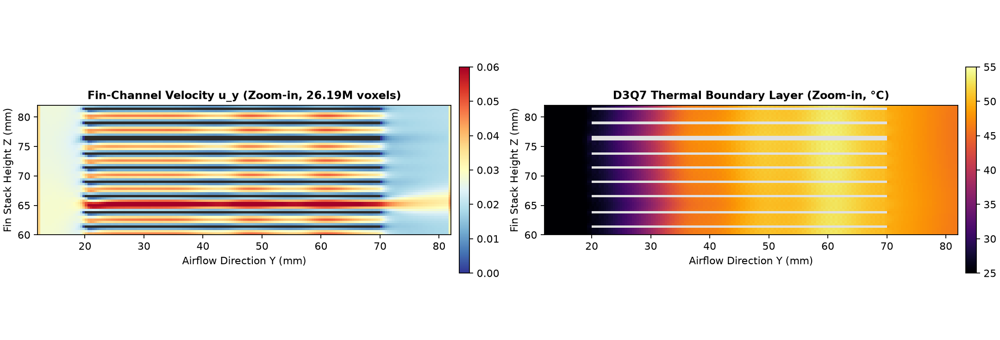
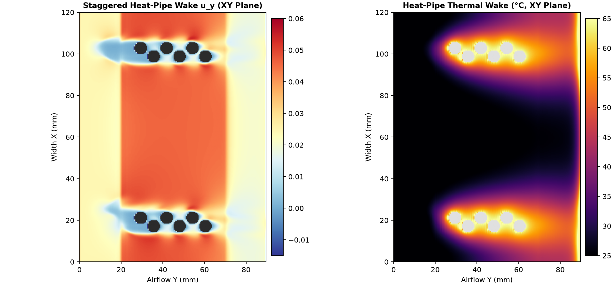
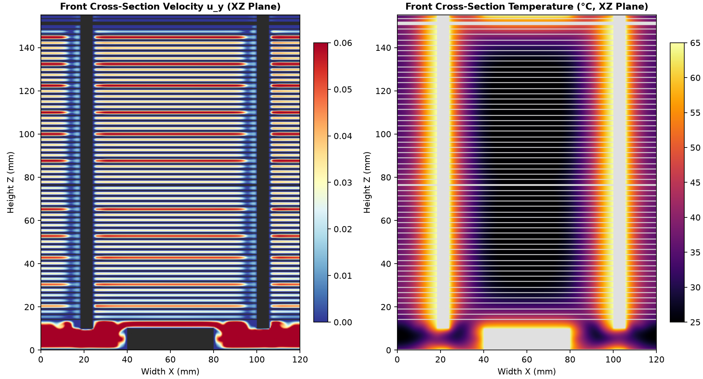

# win-cuda-lbm

Windows native CUDA C++ D3Q19/D3Q7 Lattice Boltzmann solver (BGK + Smagorinsky LES + Conjugate Heat Transfer), compiled directly with `nvcc` + MSVC into a standalone DLL (`lbm_cuda.dll`) with zero Docker / WSL / Linux dependency.


*1. Pure fin-channel zoom-in (YZ plane): parabolic channel flow (left) & D3Q7 thermal boundary layer growth (right).*


*2. Staggered heat-pipe wake (XY plane): velocity deficit & thermal wake downstream of 6 isothermal heat pipes.*


*3. Front cross-section (XZ plane): 58 stacked fins, heated baseplate, and heat-pipe thermal plume (`26.19M voxels, 1324 MLUPS on RTX 5070 Ti`).*

## Features

- **D3Q19 Fluid**: BGK + Smagorinsky SGS turbulence (`Cs`), half-way bounce-back, periodic x/z, velocity inlet / pressure outlet along y.
- **D3Q7 Thermal (Optional)**: Conjugate heat transfer (fluid advection-diffusion, solid conduction, isothermal walls).
- **AA-Pattern In-Place**: Single distribution array (`76 B/voxel` for flow), fitting 120M+ voxels on a 12 GB GPU.
- **CUDA Graph Batching**: 20-step graph launch to minimize Windows WDDM kernel dispatch overhead.
- **Zero-Dependency Python Wrapper**: `ctypes` binding in `lbm_cuda.py` (requires `numpy` only).

## Requirements

- Windows 10/11 x64
- NVIDIA CUDA Toolkit (CUDA 12.8+ for RTX 50-series `sm_120`)
- Visual Studio 2022 / C++ Build Tools
- Python 3.10+ (`numpy`)

## Build & Verify

```powershell
# Auto-detect local GPU compute capability (e.g. sm_120, sm_89, sm_80)
powershell -ExecutionPolicy Bypass -File .\build.ps1

# Or specify target architecture explicitly (e.g. A100: sm_80)
powershell -ExecutionPolicy Bypass -File .\build.ps1 -Arch sm_80

# Verify Poiseuille analytical benchmark
python .\lbm_cuda.py

# Run 26.19M-voxel 3D finned heat sink CHT example (requires matplotlib)
python .\examples\finned_heatsink.py
```

## Benchmark

Measured on a **300 × 225 × 388 (26.19M voxels)** 3D finned heat sink:

| Backend & GPU | Mode | VRAM | Throughput | Notes |
|---|---|---|---|---|
| **Native CUDA C++** (RTX 5070 Ti Laptop 12GB, `sm_120`) | Flow (D3Q19) | `1990 MB` | **~2311 MLUPS** | AA-Pattern + CUDA Graph |
| **Native CUDA C++** (RTX 5070 Ti Laptop 12GB, `sm_120`) | Flow + D3Q7 CHT | `2723 MB` | **~1302 MLUPS** | Coupled convection + conduction |
| Baseline Numba CUDA (Cloud A100 40GB, `sm_80`) | Flow (D3Q19) | `~4.0 GB` | ~1293 MLUPS | `405s` for 20,000 steps (uncoalesced `4x4x4` block) |
| Poiseuille channel (RTX 5070 Ti, `4 x 32 x 32`) | Flow (D3Q19) | `< 1 MB` | ~348 MLUPS | Error `-0.09%` vs analytical |

> **A100 (`sm_80`, 40GB/80GB, 1555 GB/s HBM2e)**: Build with `-Arch sm_80` (or compile `.cu` directly with `nvcc` on Linux/Windows). With `76 B/voxel` AA-Pattern storage, a 40 GB A100 fits **400M+ voxels** in single-GPU VRAM.

## License

MIT
